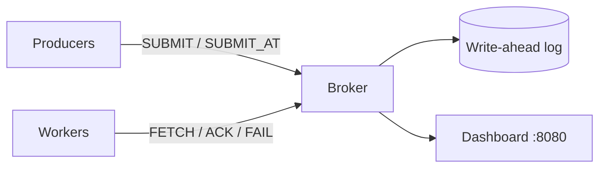

# QueueForge

A job queue written from scratch in C++17: a TCP broker, multi-process workers, priorities, delayed jobs, retries with dead-lettering, crash recovery, and a live dashboard.


## Architecture



## Features
- **Priority queue**: higher priority first, FIFO within a priority.
- **Delayed jobs**: `SUBMIT_AT <seconds> ...`, released by a timer thread.
- **Retries and dead-lettering**: failed jobs are retried up to 3 times, then marked dead.
- **Visibility timeout**: if a worker dies mid-job, the job is re-queued after 15 s (at-least-once delivery).
- **Write-ahead log**: a job is on disk before the client gets `OK`. After a crash (`kill -9`) the broker replays the log and restores queued, delayed and in-flight jobs. The log is compacted on startup.
- **Group commit**: concurrent writers share one `fsync`, so durable writes stay fast.
- **Live dashboard**: queue depth, running, done, dead, timeouts and throughput at `http://localhost:8080`.

## Protocol (one text line per command)
| Command | Reply |
|---|---|
| `SUBMIT <priority> <type> [payload]` | `OK <id>` |
| `SUBMIT_AT <delay_s> <priority> <type> [payload]` | `OK <id>` |
| `FETCH` | `JOB <id> <type> <payload>` or `EMPTY` |
| `ACK <id>` / `FAIL <id>` | `OK` |
| `STATS` | `queued=.. delayed=.. running=.. done=.. dead=..` |

## Build and run
```
cmake -S . -B build && cmake --build build
./build/broker          # terminal 1 (QF_SYNC=0 disables fsync)
./build/worker 1        # terminal 2
./build/loadtest 4 2500 4
ctest --test-dir build
```

## Benchmarks
Laptop, WSL2, broker, producers and consumers on the same machine. Every run ended with all jobs done and none dead. Results vary by 10-30% between runs.

| Mode | Load | Submit (jobs/s) | Submit p50 / p99 | Consume (jobs/s) |
|---|---|---|---|---|
| fsync off | 4 x 4, 10k jobs | 14,043 | 0.21 / 1.26 ms | 9,646 |
| fsync per job | 4 x 4, 10k jobs | 344-369 | 10.5-11.1 / 18.6-28.3 ms | 332-346 |
| group commit | 4 x 4, 10k jobs | 801 | 4.8 / 10.8 ms | 660 |
| group commit | 4 x 4, 20k jobs | 1,082 | 3.5 / 6.6 ms | 1,123 |
| group commit | 16 x 16, 10k jobs | 2,460 | 5.8 / 13.8 ms | 1,895 |

## Design notes
- Delivery is **at-least-once**: a job whose worker dies, or that runs while the broker crashes, can run twice, so jobs should be idempotent.
- A job is **live** in the log if it has an `S` line and no later `A` (done) or `D` (dead) line.

## Limitations
- One broker on one machine: no replication, so the broker is a single point of failure.
- Retry counts and the done/dead counters reset when the broker restarts.
- Text protocol, one thread per client; an epoll event loop would scale further.
- A power cut in the middle of a write could damage one log line (recovery skips it).
